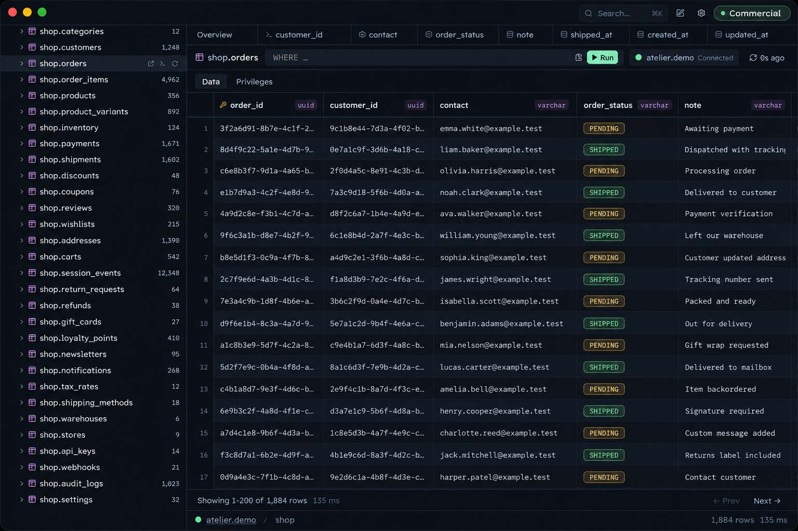

# Esploro

A SQL client for Mac. Browse and edit PostgreSQL, MySQL, and MariaDB databases, run queries, and give your AI agent read-only database access.

[Download for Mac](https://github.com/matija/esploro/releases) · [Website](https://esploro.app) · [Issues](https://github.com/matija/esploro/issues)

## Features

- Browse schemas and edit table data in a grid
- Write, run, and save SQL queries
- Let AI agents inspect schemas and query saved databases through local MCP access
- Filter table data and copy the generated SQL
- Copy values, columns, and rows as JSON or CSV
- Review database roles and table privileges
- Customize themes, fonts, and row density

## MCP access

MCP starts disabled, including after upgrading from the earlier MCP version. Existing installations receive no automatic profile grants. New Connection profiles remain unavailable until you grant access.

1. Open **Settings → MCP**.
2. Select the permitted Connection profiles.
3. Select **Enable MCP**.
4. Copy the configuration into a client that supports Streamable HTTP and bearer authentication.
5. Keep Esploro open while the client uses MCP.

The endpoint is `http://127.0.0.1:19482/mcp`. Clients discover only permitted profiles. Inspection returns separate pages of schemas, tables/views, and columns. Inspection and queries share two execution slots and a 30-second request deadline.

Settings supports enable, disable, and **Retry listener** without an app restart. Disabling MCP cancels MCP work and releases the listener. Normal app Sessions remain open.

**Replace token** requires confirmation and stops current MCP work. After successful replacement, the old token fails authentication, including on existing HTTP connections. Replace the configuration in every agent. If Keychain persistence fails, the previous token remains valid and MCP stays stopped. Review the listener status before retrying.

**Settings → MCP Activity** shows the latest 20 query attempts. SQL literals and database errors can contain sensitive information. History excludes result rows and bearer tokens. If storage fails, history stays in memory without blocking startup or successful query results.

See the [MCP reference](src-tauri/src/mcp/README.md) for client setup, pagination, limits, and SQL support.

## Download

Esploro supports macOS 13 or later. Apple Silicon and Intel builds are available on [GitHub Releases](https://github.com/matija/esploro/releases).

Personal, non-commercial use is free. Commercial use of distributed Esploro builds requires a paid license. See the [pricing page](https://esploro.app/pricing).

## Privacy

Esploro connects directly from your Mac to your database server. Queries and results do not pass through an Esploro cloud service. Database passwords stay in macOS Keychain.

MCP exposes only permitted Connection profiles. Read-only access does not prevent data disclosure. Query results can reach cloud agents. Use restricted database Roles for sensitive data. Result limits do not cap process memory for individual values received by database drivers.

Commercial license checks use an online service. See the [privacy policy](https://esploro.app/privacy) for details.

## Development

Esploro uses Tauri 2, Rust, React, and TypeScript. Issues and pull requests are welcome.

See the [development guide](docs/development.md) for local verification and MCP acceptance tests.

## Release

From the app root, run `make release` to build, notarize, and publish Apple
Silicon and Intel builds, then update and push `../esploro.web`. GitHub Actions
deploys the website. The website checkout must be clean and match its remote
default branch. Both macOS Rust targets must be installed.

To change the version, run `./build/bump.sh <version>`, then commit and push
the bump before releasing. The existing signing environment is required.

If only the website update fails, fix the error and run `npm run release:website`
to retry without rebuilding the app. If a website push failed, push that commit
from the website checkout first. `RELEASE_TAG` also applies to website updates.
The separate `build/release.sh` and `build/release-intel.sh` commands remain
available for recovery.

## License

The source code uses the [MIT License](LICENSE). Commercial use of distributed Esploro builds requires a paid license.
