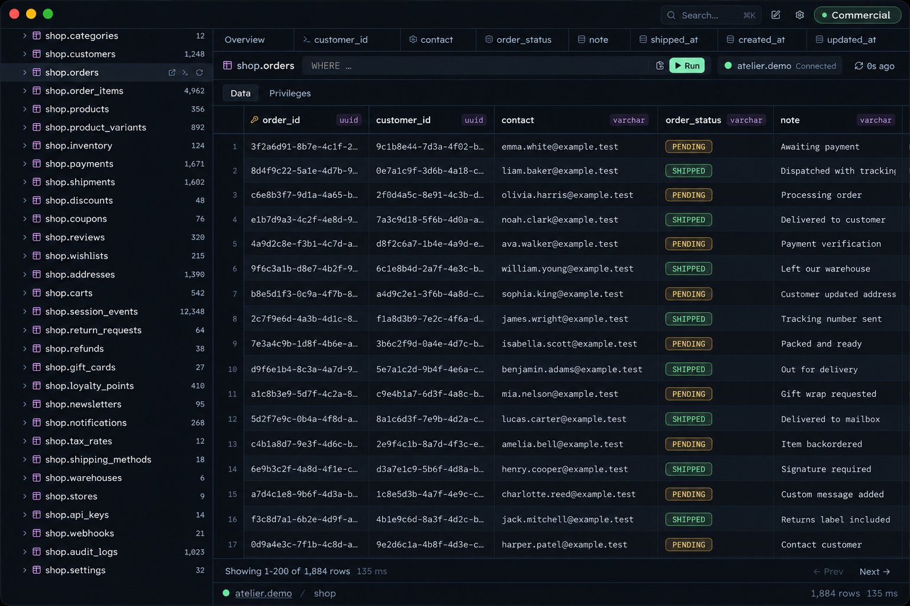

# Esploro

A SQL client for Mac. Browse and edit PostgreSQL, MySQL, and MariaDB databases, run queries, and give your AI agent read-only database access.

[Download for Mac](https://github.com/matija/esploro/releases) · [Website](https://esploro.app) · [Issues](https://github.com/matija/esploro/issues)

## Features

- Browse schemas and edit table data in a grid
- Write, run, and save SQL queries
- Let AI agents inspect schemas and query saved databases through local MCP access
- Filter table data and copy the generated SQL
- Copy values, columns, and rows as JSON or CSV
- Review database roles and table privileges
- Customize themes, fonts, and row density

For MCP access, copy the configuration from **Settings → MCP** into your agent client. Keep Esploro open. **Settings → MCP Activity** shows recent query attempts.

## Download

Esploro supports macOS 13 or later. Apple Silicon and Intel builds are available on [GitHub Releases](https://github.com/matija/esploro/releases).

Personal, non-commercial use is free. Commercial use of distributed Esploro builds requires a paid license. See the [pricing page](https://esploro.app/pricing).

## Privacy

Esploro connects directly from your Mac to your database server. Queries and results do not pass through an Esploro cloud service. Database passwords stay in macOS Keychain.

MCP access covers all saved connections. Query results can reach cloud agents. Use restricted database roles for sensitive data.

Commercial license checks use an online service. See the [privacy policy](https://esploro.app/privacy) for details.

## Development

Esploro uses Tauri 2, Rust, React, and TypeScript. Issues and pull requests are welcome.

See the [development guide](docs/development.md) for local verification and MCP acceptance tests.

## Release

From the app root, run `make release` to build, notarize, and publish Apple
Silicon and Intel builds, then update and push `../esploro.web`. GitHub Actions
deploys the website. The website checkout must be clean and match its remote
default branch. Both macOS Rust targets must be installed.

To change the version, run `./build/bump.sh <version>`, then commit and push
the bump before releasing. The existing signing environment is required.

If only the website update fails, fix the error and run `npm run release:website`
to retry without rebuilding the app. If a website push failed, push that commit
from the website checkout first. `RELEASE_TAG` also applies to website updates.
The separate `build/release.sh` and `build/release-intel.sh` commands remain
available for recovery.

## License

The source code uses the [MIT License](LICENSE). Commercial use of distributed Esploro builds requires a paid license.
